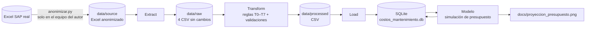
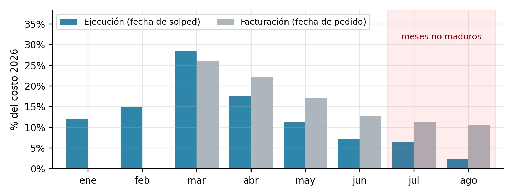
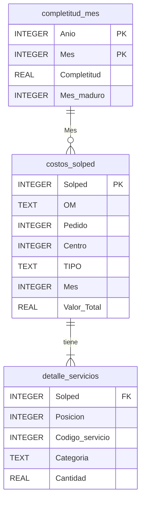
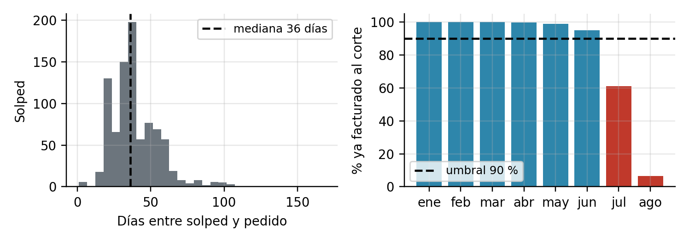
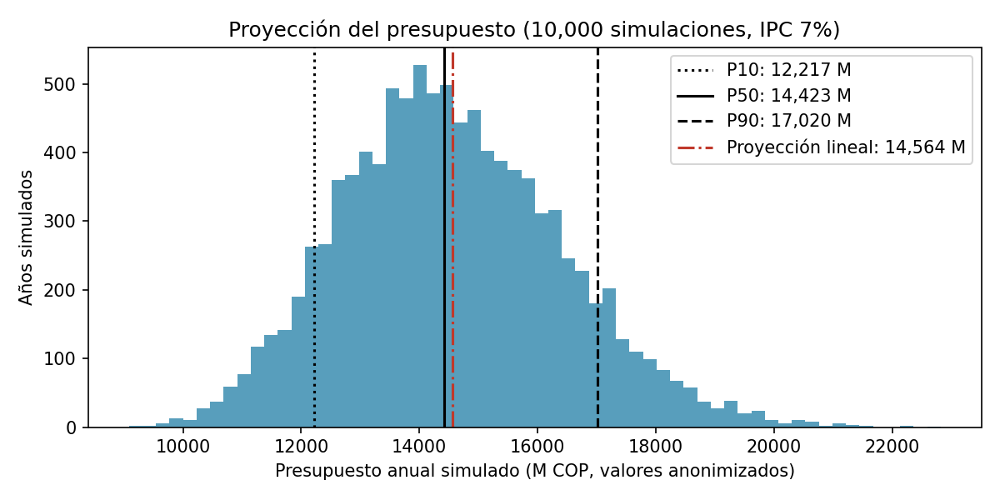

# Proyección del presupuesto de mantenimiento de postes y transformadores

> Pipeline ETL que toma cuatro exportaciones de SAP (pedidos, solicitudes de pedido, servicios y materiales), reconstruye el costo real de cada actividad de cambio o instalación de postes y transformadores, lo carga en una base SQLite y proyecta el presupuesto del año siguiente como un rango (P10–P50–P90).

**Curso:** ETL — Maestría en Inteligencia Artificial y Ciencia de Datos, Universidad Autónoma de Occidente
**Periodo:** 2026-2
**Docente:** Fernando Barraza Alvarado

## Integrantes

| Nombre | Usuario de GitHub |
|---|---|
| Esteban Urueña Sanmiguel | [@jesteban1993](https://github.com/jesteban1993) |

## Tabla de contenido

1. [Descripción del problema](#1-descripción-del-problema)
2. [Fuentes de datos](#2-fuentes-de-datos)
3. [Arquitectura del pipeline](#3-arquitectura-del-pipeline)
4. [Estructura del repositorio](#4-estructura-del-repositorio)
5. [Requisitos](#5-requisitos)
6. [Instalación y configuración](#6-instalación-y-configuración)
7. [Ejecución](#7-ejecución)
8. [Detalle de las etapas ETL](#8-detalle-de-las-etapas-etl)
9. [Modelo y diccionario de datos](#9-modelo-y-diccionario-de-datos)
10. [Calidad de datos y validaciones](#10-calidad-de-datos-y-validaciones)
11. [Resultados](#11-resultados)
12. [Limitaciones y trabajo futuro](#12-limitaciones-y-trabajo-futuro)
13. [Referencias](#13-referencias)

## 1. Descripción del problema

Cada segundo semestre, el área de Mantenimiento de redes de distribución de Celsia proyecta el presupuesto de inversión (CAPEX) del año siguiente para el cambio o instalación de postes y transformadores. La cantidad de actividades no se programa: depende de los daños reales de la red (postes partidos, transformadores quemados, tormentas). El costo real de cada actividad solo existe en SAP, repartido en una cadena de documentos (pedido → solicitud de pedido → orden de mantenimiento → servicios y materiales) que hoy se reconstruye a mano cruzando cuatro transacciones. El proceso manual es lento, difícil de repetir y, como se verificó en la Entrega 2, tenía errores de doble conteo y de clasificación.

**Objetivo:** dejar disponible una base estructurada y trazable con el costo real de cada actividad (servicio + material) por tipo de activo, centro y mes de ejecución, y usarla para estimar el presupuesto del año siguiente con un rango de confianza que apoye la decisión de cuánto solicitar.

## 2. Fuentes de datos

Las cuatro fuentes son exportaciones manuales de SAP-HANA (ERP interno de Celsia), autorizadas por el área de Mantenimiento para uso académico con la condición de no publicar valores reales ni el nombre del contratista. Por eso el repositorio contiene una **versión anonimizada** (`data/source/Postes_Trafos_anon.xlsx`): valores monetarios multiplicados por un factor de ajuste, contratista y usuarios SAP reemplazados por códigos.

| Fuente | Tipo | Origen | Tamaño aprox. | Frecuencia de actualización | Licencia / uso |
|---|---|---|---|---|---|
| ME2N — pedidos de los contratos marco | Exportación XLSX | SAP-HANA (interno) | 6.756 filas × 16 columnas | Bajo demanda (mensual) | Uso académico autorizado, datos anonimizados |
| ME5K — solicitudes de pedido (solped), OM y valor | Exportación XLSX | SAP-HANA (interno) | 7.639 filas × 20 columnas | Bajo demanda (mensual) | Uso académico autorizado, datos anonimizados |
| MSRV5 — servicios de cada solped (19 códigos de poste/trafo) | Exportación XLSX | SAP-HANA (interno) | 1.041 filas × 10 columnas | Bajo demanda (mensual) | Uso académico autorizado, datos anonimizados |
| MB51 — movimientos de material por OM (261 salida, 262 retorno) | Exportación XLSX | SAP-HANA (interno) | 18.451 filas × 22 columnas | Bajo demanda (mensual) | Uso académico autorizado, datos anonimizados |
| Estimado de cierre del IPC 2026 (7 %) | Parámetro | Encuesta Mensual de Expectativas de Analistas Económicos — [Banco de la República](https://www.banrep.gov.co) (septiembre 2026: 6,81 %, redondeado a 7 %) | 1 valor | Mensual | Pública |

Periodo: pedidos creados entre el 29-dic-2025 y el 31-ago-2026.

## 3. Arquitectura del pipeline



El pipeline es **ETL por lotes**: las fuentes llegan como exportaciones manuales de SAP, así que no hay API ni base de datos de origen a la cual conectarse. Cada etapa deja su salida en disco para que sea trazable (raw → processed → base de datos). El destino es **SQLite** porque es una base de datos relacional real en un solo archivo, sin servidor, que permite definir esquema, llaves y vistas y consultar con SQL; el volumen (menos de mil solped por año) no justifica un motor más pesado. La anonimización se separa del pipeline para que los datos reales nunca entren al repositorio.

**Tecnologías:** Python 3.11, pandas, NumPy, openpyxl, SQLite (`sqlite3`), Matplotlib, python-dotenv.

## 4. Estructura del repositorio

```
├── data
│   ├── source         <- Exportación SAP anonimizada (entrada del pipeline).
│   ├── raw            <- Las 4 hojas extraídas a CSV, sin modificar.
│   └── processed      <- Tablas finales en CSV y la base SQLite costos_mantenimiento.db.
│
├── extract            <- extract.py: lee las 4 hojas y las guarda en data/raw.
├── transform          <- transform.py: reglas T0–T7 y validaciones de calidad.
├── load               <- load.py: crea el esquema y carga las tablas en SQLite.
├── model              <- proyeccion.py: simulación del presupuesto del año siguiente.
├── docs               <- Gráficos e informes de las Entregas 1 y 2 (EDA y calidad de datos).
│
├── pipeline.py        <- Orquesta la ejecución completa (extract → transform → load → modelo).
├── config.py          <- Rutas, reglas de negocio y parámetros (IPC, umbrales).
├── anonimizar.py      <- Genera data/source a partir del Excel real (solo se ejecuta localmente).
├── requirements.txt   <- Dependencias del proyecto.
├── .env.example       <- Variables de entorno requeridas (sin valores).
├── .gitignore         <- Excluye .env, entornos virtuales y los datos reales.
└── README.md          <- Este archivo.
```

## 5. Requisitos

- Python 3.11 o superior
- Dependencias listadas en `requirements.txt` (SQLite viene incluido con Python)

## 6. Instalación y configuración

```bash
# 1. Clonar el repositorio
git clone https://github.com/jesteban1993/etl-presupuesto-postes-trafos.git
cd etl-presupuesto-postes-trafos

# 2. Crear y activar el entorno virtual
python -m venv .venv
source .venv/bin/activate        # Windows: .venv\Scripts\activate

# 3. Instalar dependencias
pip install -r requirements.txt
```

### Variables de entorno

Copie `.env.example` como `.env`. Para ejecutar el pipeline solo se necesita `IPC_CIERRE` (si no se define, se usa 0.07). Las otras dos variables las usa únicamente el autor para generar la versión anonimizada.

| Variable | Descripción | Ejemplo |
|---|---|---|
| `IPC_CIERRE` | Estimado de cierre del IPC del año en curso (decimal) | `0.07` |
| `FACTOR_ANON` | Factor de ajuste de los valores monetarios (solo `anonimizar.py`) | — |
| `RUTA_EXCEL_ORIGINAL` | Ruta del Excel real exportado de SAP (solo `anonimizar.py`) | — |

### Obtención de los datos

Los datos anonimizados ya están en `data/source/Postes_Trafos_anon.xlsx`; no hay que descargar nada. Para regenerarlos desde SAP (solo el autor): exportar ME2N, ME5K, MSRV5 y MB51 a un Excel con una hoja por transacción, definir `FACTOR_ANON` y `RUTA_EXCEL_ORIGINAL` en `.env` y ejecutar `python anonimizar.py`.

## 7. Ejecución

```bash
# Pipeline completo
python pipeline.py
```

```bash
# Por etapas (opcional)
python extract/extract.py
python transform/transform.py
python load/load.py
python model/proyeccion.py
```

**Salida esperada** (≈ 15 segundos):
- `data/raw/`: `me2n.csv`, `me5k.csv`, `msrv5.csv`, `mb51.csv`
- `data/processed/`: `costos_solped.csv`, `detalle_servicios.csv`, `completitud_mes.csv`, `validaciones.csv`, `proyeccion.csv` y `costos_mantenimiento.db`
- `docs/proyeccion_presupuesto.png`
- En consola: tabla de validaciones, conteo de filas cargadas y la proyección del presupuesto.

## 8. Detalle de las etapas ETL

### 8.1 Extract

- **Qué hace:** lee las cuatro hojas de la exportación SAP y las guarda sin ningún cambio como CSV, para que la etapa de transformación siempre parta de una copia fiel de la fuente.
- **Scripts:** `extract/extract.py`
- **Salida:** `data/raw/me2n.csv`, `me5k.csv`, `msrv5.csv`, `mb51.csv`

### 8.2 Transform

- **Qué hace:** integra las cuatro fuentes en una tabla con **una fila por solicitud de pedido (solped)**, calcula el costo de servicio y de material, asigna el mes de ejecución y marca qué meses están completos. Las reglas salen del EDA y del análisis de calidad de la Entrega 2 (ver `docs/ETL_Entrega_2.pdf`).
- **Scripts:** `transform/transform.py`
- **Salida:** `data/processed/costos_solped.csv`, `detalle_servicios.csv`, `completitud_mes.csv`, `validaciones.csv`

| # | Transformación | Justificación |
|---|---|---|
| T0 | Una línea por (solped, posición, servicio) en MSRV5; si viene repetida se conserva la de mayor valor | La exportación trae 3 líneas repetidas que inflaban el conteo de servicios |
| T1 | Solo solped con OM que inicia por "400" (ME5K) | Las OM vacías o inválidas no corresponden a una actividad de mantenimiento |
| T2 | Cada código de servicio se clasifica como Poste o Trafo con un mapa fijo de 19 códigos | Reemplaza la clasificación manual línea a línea, que tenía errores |
| T3 | Una fila por solped; TIPO = TD si la solped tiene algún servicio de trafo, si no Poste | El valor del pedido es de la solped completa: sumar línea a línea duplicaba el valor |
| T4 | Valor_Servicio = valor neto de la solped en ME5K × 1,19 (IVA) | Costo real del servicio |
| T5 | Material de la OM = −(261 + 262) en MB51, sin filtro de fecha | Balance de salidas y retornos imputado a la OM |
| T5b | Se excluyen las solped cuya OM no tiene movimientos en MB51 | Validado con el área: su material se pagó con otras OM, su costo está incompleto |
| T6 | Si una OM tiene varias solped, su material se reparte en proporción al Valor_Servicio | Evita contar dos veces el material de la OM |
| T7 | Mes = fecha de creación de la solped; completitud por mes; solo meses con completitud ≥ 90 % entran al modelo | La fecha de pedido refleja la facturación (rezago mediano de 36 días), no la ejecución; julio y agosto aún no están facturados |



### 8.3 Load

- **Qué hace:** crea el esquema (tablas con tipos, llaves primarias, llave foránea y restricciones `CHECK`) y carga las tablas procesadas. Modo **reemplazo**: cada ejecución reconstruye la base completa a partir de la fuente, lo que garantiza que el resultado siempre corresponde a la última extracción.
- **Scripts:** `load/load.py`
- **Destino:** SQLite, `data/processed/costos_mantenimiento.db`

## 9. Modelo y diccionario de datos



Además: tabla `validaciones`, tablas de resultados del modelo `proyeccion` y `validacion_modelo`, y las vistas `v_base_modelo` (solped de meses maduros) y `v_resumen_mensual` (costo por mes, tipo y centro).

**Tabla principal:** `costos_solped` (una fila por solped)

| Columna | Tipo | Descripción | Ejemplo |
|---|---|---|---|
| `Solped` | int | Solicitud de pedido (llave primaria) | 1000652912 |
| `OM` | text | Orden de mantenimiento | 400869485 |
| `Pedido` | int | Pedido que facturó la solped | 4100074331 |
| `Contrato_marco` | int | Contrato marco del pedido | 3100001768 |
| `Centro` | int | Centro de operación | 1316 |
| `TIPO` | text | Poste o TD (transformador de distribución) | Poste |
| `Fecha_solped` | date | Creación de la solped (≈ ejecución) | 2026-01-05 |
| `Fecha_pedido` | date | Creación del pedido (facturación) | 2026-03-11 |
| `Anio`, `Mes` | int | Año y mes de ejecución | 2026, 1 |
| `Rezago_dias` | int | Días entre solped y pedido | 65 |
| `n_servicios`, `n_poste`, `n_trafo` | int | Líneas de servicio de la solped, total y por categoría | 2, 2, 0 |
| `Cantidad_servicios` | real | Unidades de servicio ejecutadas | 5 |
| `Valor_Servicio` | real | Valor neto de la solped × IVA (COP, anonimizado) | 12.092.654 |
| `Material_OM_total` | real | Material neto de la OM en MB51 (COP, anonimizado) | 15.691.351 |
| `n_solped_OM` | int | Solped que comparten la OM | 1 |
| `Valor_Material` | real | Material asignado a la solped (COP, anonimizado) | 15.691.351 |
| `Valor_Total` | real | Servicio + material (COP, anonimizado) | 27.784.005 |
| `Costo_unitario` | real | Valor_Total / Cantidad_servicios | 5.556.801 |
| `Completitud` | real | % estimado de solped del mes ya facturadas al corte | 1.0 |
| `Mes_maduro` | int | 1 si la completitud del mes es ≥ 90 % | 1 |

## 10. Calidad de datos y validaciones

Tabla generada en cada ejecución (`validaciones` en la base de datos):

| Verificación | Antes | Después |
|---|---|---|
| Líneas de servicio MSRV5 | 1.041 | 944 (2026) |
| Líneas MSRV5 repetidas (T0) | 3 | 0 |
| Solped | 977 | 887 (una fila por solped) |
| Solped duplicadas en la tabla final | — | 0 |
| Solped sin OM válida (T1) | 3 | 0 |
| Solped sin material en MB51 (T5b) | 16 | 0 |
| OM compartidas por varias solped (T6) | 1 | material repartido |
| Solped con más de un pedido | 0 | 0 |
| Servicios fuera de los 19 códigos | 0 | 0 |
| Nulos en columnas clave (Solped, OM, TIPO, Valor_Total) | — | 0 |
| Solped en meses maduros (base del modelo) | — | 770 |

Completitud por mes al corte (31-ago-2026): enero a mayo ≥ 99 %, junio 95 %, **julio 61 % y agosto 7 %** (fuera del modelo).



La conciliación contra el cálculo manual del área explicó el 100 % de las diferencias: material duplicado en solped con varias líneas, material de una OM compartida contado dos veces y solped mal clasificadas que no se sumaban (detalle en `docs/ETL_Entrega_2.pdf`).

## 11. Resultados

**Base resultante:** 770 solped de enero a junio de 2026 (388 de Poste y 382 de TD).

**Producto de datos — proyección del presupuesto del año siguiente.** El modelo (`model/proyeccion.py`) simula 10.000 años posibles: cada año toma 12 meses al azar (con reemplazo) entre los 6 meses observados, suma su costo y aplica el IPC estimado (7 %). Los percentiles de esos 10.000 resultados dan el presupuesto más probable (P50) y uno con 90 % de confianza (P90). Se usa una semilla fija, por lo que cada ejecución da exactamente el mismo resultado. Se compara con la proyección lineal: costo mensual promedio observado × 12 × 1,07.

| Segmento | Proyección lineal | P10 | P50 | P90 |
|---|---|---|---|---|
| Poste | 7.680 | 6.119 | 7.574 | 9.326 |
| TD | 6.884 | 6.098 | 6.855 | 7.688 |
| **Total** | **14.564** | **12.217** | **14.423** | **17.020** |

*Millones de COP, valores anonimizados.*



**Lectura para la decisión:** la proyección lineal coincide con el escenario más probable, pero es un único valor que no dice nada del riesgo. Para tener 90 % de confianza de no quedarse corto, el presupuesto debe ser cerca de **17 % mayor** que la proyección lineal.

**Alternativa evaluada y descartada:** se probaron modelos de regresión (lineal y random forest) para predecir el costo de cada solped a partir de su tipo, centro y servicios. Explicaron apenas entre el 20 % y el 26 % de la variación (R² de 0,20 a 0,26), porque el costo depende sobre todo del material y de obras puntuales de gran tamaño, que no están en las variables disponibles. Por eso se eligió la simulación sobre los costos observados.

```sql
-- Costo mensual de ejecución por tipo (meses maduros)
SELECT Mes, TIPO, COUNT(*) AS Solped, ROUND(SUM(Valor_Total) / 1e6, 1) AS Costo_M
FROM v_base_modelo
GROUP BY Mes, TIPO
ORDER BY Mes, TIPO;

-- Proyección del presupuesto del año siguiente
SELECT Segmento, ROUND(P50 / 1e6) AS P50_M, ROUND(P90 / 1e6) AS P90_M
FROM proyeccion;
```

## 12. Limitaciones y trabajo futuro

- **Estacionalidad:** los daños aumentan en las temporadas de lluvia (marzo–mayo y octubre–noviembre). Con solo seis meses, la proyección supone que el segundo semestre repite el ciclo del primero. Una prueba de validación (proyectar mayo–junio con enero–abril) confirmó que los meses no son intercambiables entre sí, por lo que el rango P10–P90 probablemente subestima la incertidumbre real.
- **Un solo año de datos:** el periodo cubre enero–junio de 2026 bajo el contrato vigente. Incorporar años completos anteriores, disponibles en SAP, permitiría modelar la estacionalidad mes a mes y medir tendencias.
- **Meses recientes incompletos:** julio y agosto quedaron fuera por el rezago de facturación. Una nueva extracción los completaría sin cambiar el código.
- **Extracción manual:** las fuentes se exportan a mano desde SAP. Una conexión directa o una exportación programada permitiría carga incremental y ejecución automática mensual.
- **Solped excluidas:** 16 solped cuyo material se pagó con otras OM se excluyen; identificar esas OM permitiría recuperar su costo completo.

## 13. Referencias

- Banco de la República. *Encuesta Mensual de Expectativas de Analistas Económicos*, septiembre de 2026. https://www.banrep.gov.co — reseña de los resultados: [La República, "Encuesta del Emisor elevó su pronóstico de inflación, ahora la ve cerca de 7 %"](https://www.larepublica.co/economia/banco-de-la-republica-elevo-su-pronostico-de-inflacion-ahora-la-ve-cerca-de-7-4484005)
- Informes de avance del proyecto: `docs/ETL_Entrega_1.pdf` (contexto, problema y fuentes) y `docs/ETL_Entrega_2.pdf` (EDA, calidad de datos y transformaciones).
- Documentación de pandas: https://pandas.pydata.org/docs/ — SQLite: https://www.sqlite.org/docs.html
- Uso de IA generativa: se utilizó Claude (Anthropic) como apoyo en la revisión de datos, la redacción y la estructuración del código. Las reglas de negocio, las validaciones con el área de Mantenimiento y las decisiones del proyecto son del autor.
